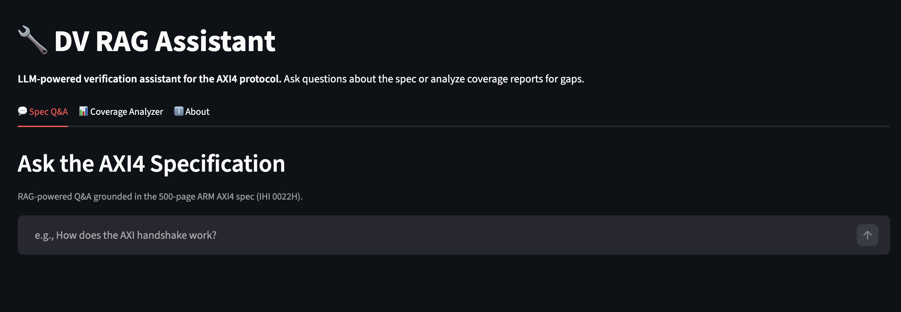
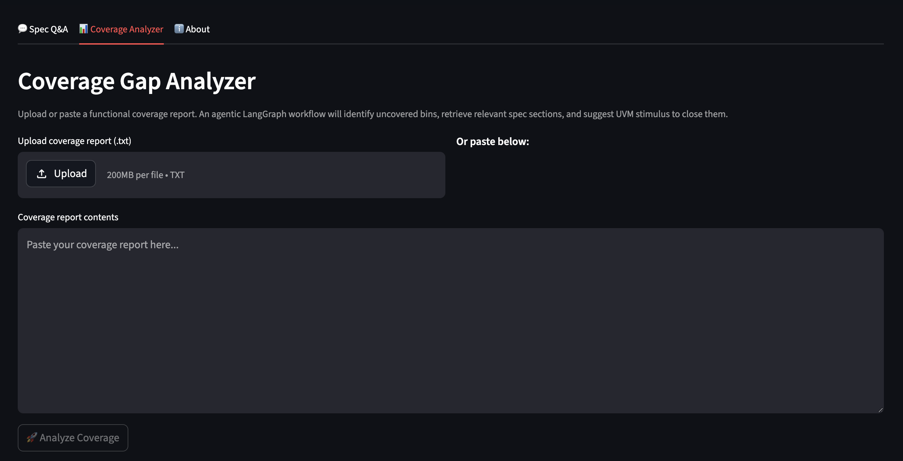
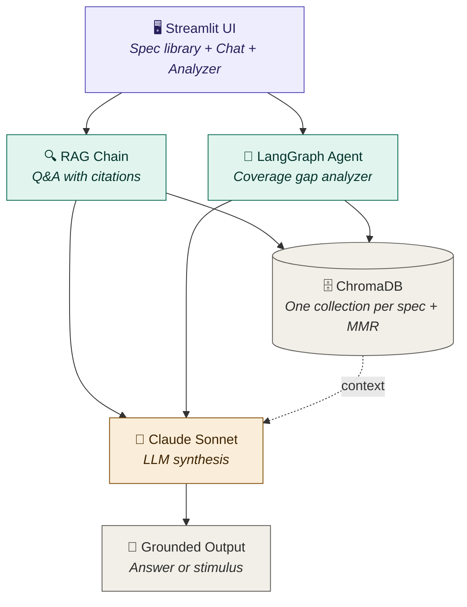
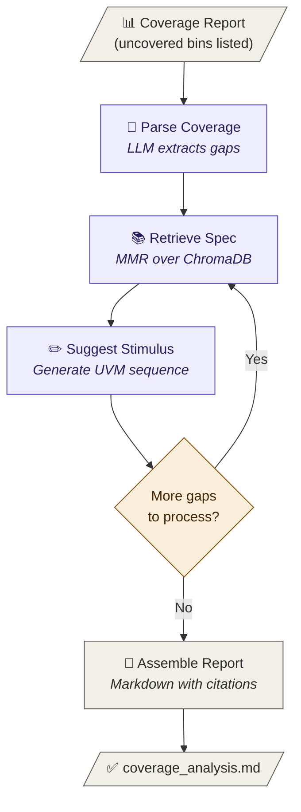

# 🔧 DV RAG Assistant

> An LLM-powered verification assistant for **any specification** — AXI, APB, PCIe, RISC-V, your own block spec.
> Upload the PDF, ask it questions in plain English, or upload a coverage report and let an agent suggest UVM stimulus to close the gaps.

[](https://www.python.org/)
[](https://www.langchain.com/)
[](https://langchain-ai.github.io/langgraph/)
[](https://streamlit.io/)
[](https://www.anthropic.com/)

---

## 📋 Overview

Modern Design Verification (DV) engineers spend hours hunting through 500-page protocol specifications and analyzing coverage reports for missed scenarios. **This project automates both.**

Three capabilities, one system:

1. **Spec Library** — Upload any specification PDF from the sidebar. Each spec is cleaned, chunked, embedded and stored in its own vector collection; switch between specs from a dropdown.
2. **Spec Q&A** — Conversational RAG (Retrieval-Augmented Generation) over the selected spec. Ask any question, get answers grounded in the actual spec with page citations.
3. **Coverage Gap Analyzer** — A LangGraph agent that parses functional coverage reports, identifies uncovered bins, retrieves relevant context from the selected spec for each gap, and suggests concrete UVM constrained-random stimulus to close them.

It started as an AXI4-only tool; nothing in the pipeline is AXI-specific any more.

---

## 🎬 Demo


| Spec Q&A | Coverage Analyzer |
|----------|-------------------|
|  |  |

---

## 🏗️ Architecture

### System Architecture



### Coverage Analyzer Agent (LangGraph)



The agent is implemented as a stateful `StateGraph` — the loop between `Retrieve` and `Suggest` runs once per identified coverage gap, with conditional branching back via `add_conditional_edges`.

### RAG Pipeline
```
Any spec PDF (upload in UI or `python ingest.py`)
   ↓ PyPDFLoader + automatic header/footer and contents-page detection
Cleaned pages (boilerplate stripped, TOC dropped)
   ↓ RecursiveCharacterTextSplitter (1500 chars, 300 overlap)
Semantic chunks (AXI4: ~780 chunks from 500 pages)
   ↓ HuggingFace all-MiniLM-L6-v2 (local embedding)
384-dim vectors
   ↓ ChromaDB (persistent on-disk, one collection per spec)
Searchable spec library
   ↓ MMR retrieval (k=10, fetch_k=25, λ=0.5)
Diversified context
   ↓ Claude Sonnet + grounded prompt (chunks tagged with page numbers)
Answer with page citations
```

### Coverage Agent (LangGraph)
```
Coverage Report
     ↓
[Parse] → identify uncovered bins
     ↓
┌──→ [Retrieve] → fetch relevant spec context
│         ↓
│    [Suggest] → generate UVM stimulus
│         ↓
└─── (loop until all gaps processed)
          ↓
     [Assemble] → final markdown report
```

The agent is implemented as a stateful `StateGraph` with conditional edges — a real multi-step agentic workflow, not a sequential pipeline.

---

## 🛠️ Tech Stack

| Layer | Tool |
|-------|------|
| LLM | Anthropic Claude Sonnet (`claude-sonnet-5-5`; override with `LLM_MODEL` in `.env`) |
| RAG framework | LangChain 1.x |
| Agent framework | LangGraph |
| Vector DB | ChromaDB (persistent) |
| Embeddings | sentence-transformers `all-MiniLM-L6-v2` (local, free) |
| PDF parsing | PyPDF + spec-agnostic boilerplate/TOC detection |
| UI | Streamlit |
| Language | Python 3.11+ |

**Why these choices:**
- **Local embeddings** keep ingestion free and the spec on your machine
- **MMR over similarity search** prevents top-k from being 8 near-duplicate chunks
- **LangGraph over LangChain agents** for explicit, debuggable state transitions
- **ChromaDB over Pinecone/Weaviate** for zero-infra local development

---

## 🚀 Quick Start

### 1. Clone & install
```bash
git clone https://github.com/Dhirajzen/dv-rag-assistant.git
cd dv-rag-assistant
python -m venv venv
source venv/bin/activate          # macOS/Linux
# venv\Scripts\activate           # Windows
pip install -r requirements.txt
```

### 2. Set up your API key
Create a `.env` file in the project root:
```bash
ANTHROPIC_API_KEY=sk-ant-your-key-here
```
Get a key at [console.anthropic.com](https://console.anthropic.com).

### 3. Run the app
```bash
python -m streamlit run app.py
```

### 4. Add a spec
In the sidebar open **➕ Add a spec**, upload any specification PDF, give it a name, and click **Ingest spec**. It is cleaned, chunked, embedded and added to the library (a 500-page spec takes well under a minute). Add as many specs as you like and switch between them with the **Active spec** dropdown.

For example, the AMBA AXI Protocol Specification is a free download from [ARM Developer](https://developer.arm.com/documentation/ihi0022/).

### CLI alternative
```bash
python ingest.py data/axi4_spec.pdf --name "AXI4"   # add a spec
python ingest.py --list                              # show the library
python ingest.py --delete "AXI4"                     # remove a spec

python rag.py "AXI4"                                 # interactive Spec Q&A
python agent.py "AXI4" data/coverage_report.txt      # run coverage gap analyzer
```

---

## 📁 Project Structure

```
dv-rag-assistant/
├── app.py                # Streamlit UI (spec library sidebar + Q&A + coverage analyzer tabs)
├── specs.py              # Spec library: PDF cleaning, chunking, embedding, one collection per spec
├── ingest.py             # CLI for the spec library (add / list / delete)
├── rag.py                # MMR retrieval + grounded prompt with page citations
├── agent.py              # LangGraph agent for coverage gap analysis
├── test_llm.py           # Sanity check for API connectivity
├── test_retrieval.py     # Inspect retrieval quality
├── requirements.txt
├── .env                  # (not committed) API key
├── data/
│   └── coverage_report.txt   # sample (AXI4) functional coverage report
├── chroma_db/            # (not committed) vector DB, one collection per ingested spec
└── README.md
```

---

## 🧠 Engineering Decisions & Challenges

A short post-mortem of the non-obvious problems hit while building this — the actual interesting parts.

### Problem 1: Table of contents was outranking real content
**Symptom:** Asking "Describe the AXI handshake protocol" returned chunks from the TOC ("Chapter A3 describes the basic AXI protocol transaction requirements...") because TOC entries were lexically similar to natural-language queries.
**Fix:** Originally a hardcoded "skip the first N pages". Now spec-agnostic: any page that is mostly dot-leader lines ending in a page reference is detected as a contents page and dropped.

### Problem 2: Page headers/footers polluting chunks
**Symptom:** Top retrieved chunks were mostly "ARM IHI 0022H Copyright © 2003-2020..." boilerplate.
**Fix:** Originally ARM-specific regexes. Now spec-agnostic: lines that recur at the top/bottom of many pages (with digits normalised, so page numbers don't hide them) are detected as running headers/footers and stripped before chunking.

### Problem 3: Top-k retrieval returning near-duplicate chunks
**Symptom:** Asking about AXI4-Lite handshake returned 8 chunks all from pages 118-122, missing the foundational handshake description in Chapter A3.
**Fix:** Switched from similarity search to **Maximal Marginal Relevance (MMR)** retrieval, which balances relevance with diversity (`fetch_k=25, k=10, λ=0.5`).

### Problem 4: LLM refusing to synthesize when context was partial
**Symptom:** Even with relevant chunks present, Claude would refuse with "not enough information."
**Fix:** Prompt engineering — explicitly instructed the LLM to synthesize across chunks and use partial information rather than refuse on first uncertainty.

These four are the canonical RAG challenges that every production system has to solve. Working through them was where the real learning happened.

---

## 🔮 Future Work

- Add reranking with `cohere` or cross-encoder models for higher-precision retrieval
- Query across several specs at once (e.g. AXI + your block spec)
- Non-PDF specs (Word, Markdown, HTML) and OCR for scanned PDFs
- Parse real VCS/Questa URG output (not just synthetic reports)
- Generate actual SystemVerilog files instead of code sketches
- Add evaluation harness with ground-truth Q&A pairs

---

## 👤 Author

**Dhirajzen Bagawath Geetha Kumaravel**
MS Computer Engineering, NYU (May 2026)
Targeting Design Verification roles in semiconductor / hardware.

- 📧 db5309@nyu.edu
- 💼 [LinkedIn](https://linkedin.com/in/dhirajzen30)
- 🔗 [GitHub](https://github.com/Dhirajzen)

---

## 📜 License

MIT — feel free to use, modify, and learn from.

No specifications are redistributed in this repo; bring your own PDFs.
